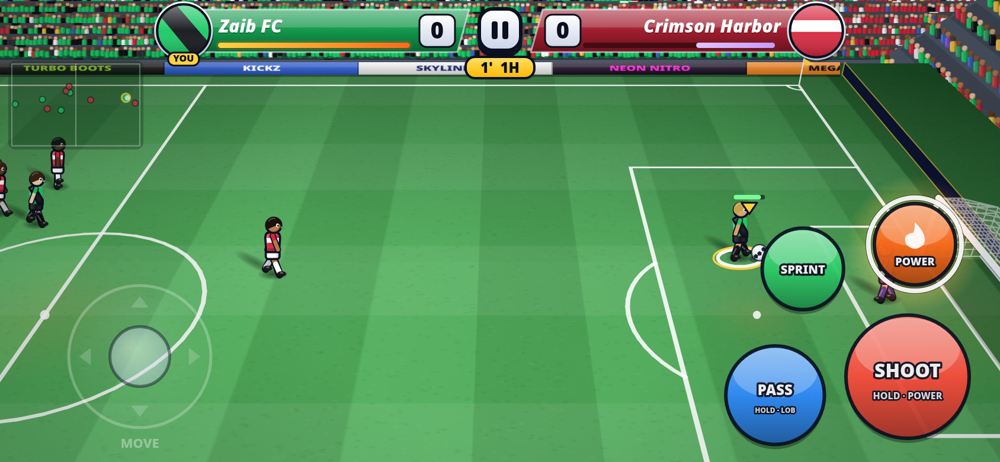
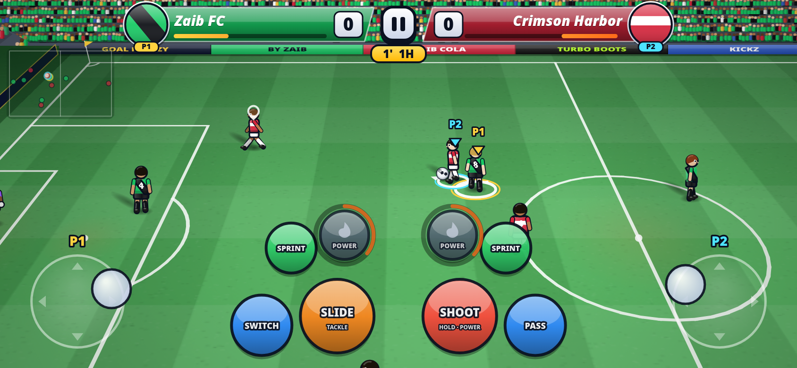
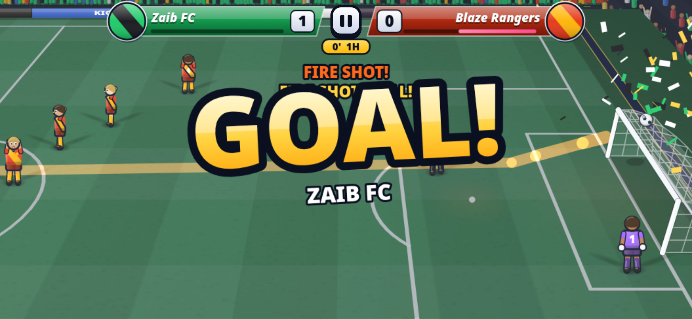
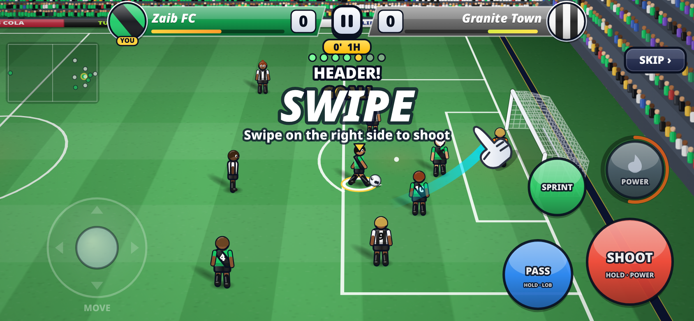

# Goal Frenzy by Zaib

A fast, glossy **arcade football (soccer)** game for mobile browsers. Built as a single self-contained HTML file with no libraries and no downloads.

**▶ Play now: https://wahidzeb.github.io/goal-frenzy/**

## Features
- **3D-perspective stadium:** true perspective camera with smooth cinematic follow and low-angle goal replays.
  - Textured, cross-mown grass with lighting.
  - Two-tier crowd, roof with floodlights, a wall of flags, team flags and banners.
  - Day, dusk and night. Long soft shadows from the sun or floodlights.
  - Translucent rippling nets.
- **Players:** shaded kits, faces and hair, run, kick, slide, dive and three celebration styles.
- **HUD:** glossy corner score panels with team badges.
- **Ball physics:** height and shadow, curling shots, lobs and through balls, posts and crossbar, throw-ins, corners and goal kicks.
- **Teams:** 5v5 or 7v7.
- **Smarter AI:** teammates make runs and offer support. Opponents press, mark and block shooting lanes. Keepers read shots better. Bot-vs-bot games on Normal average about 3–4 goals per 3-minute match.
- **2 Players on one device:** Quick Match and Penalty Shootout. P1 uses the left half of the screen and P2 the right half, each with their own stick and buttons and full multi-touch. Pick a team and kit for each player. On a keyboard: P1 WASD, P2 arrows.
- **Training:** an interactive tutorial with hand hints. It starts on your first Quick Match and is always available from How to Play.
- **Power shots:** charge the meter and fire Fire Shot, Banana Curve, Lightning Dash, Freeze Blast, Giant Keeper, Phantom Shot or Sky Meteor. The CPU has powers too.
- **Modes:**
  - Quick Match (1 Player vs CPU or 2 Players)
  - Zaib Cup: 8-team knockout. A draw goes to penalties.
  - League: 8 teams, 7 matchdays
  - Penalty Shootout: swipe to shoot, tap to dive (1P or 2P, taking turns)
- **Difficulty:** Easy, Normal, Hard and Legend.
- **Clubs and progression:**
  - 16 fictional clubs.
  - Your own club with a custom name, short name, kit colours and pattern.
  - Earn coins to buy upgrades (pace, shooting, passing, tackling, keeper, stamina) and to unlock or level up power shots.
- **Match presentation:** slow-mo goal replays, commentator callouts, celebrations, confetti, screen shake, particles and ball trails.
- **Sound:** WebAudio crowd, whistle, kicks and music.
- **Saving:** progress is saved in localStorage.

## Controls
**Touch (landscape recommended):**
| Control | Action |
|---|---|
| Left thumb | Move (floating joystick) |
| SHOOT | Tap to shoot; hold for power; swipe across the button to curl |
| PASS | Tap for a ground pass; hold for a lob or through ball |
| SPRINT | Hold to run faster (uses stamina) |
| POWER | Arm a charged power shot |
| Without the ball | SHOOT becomes **SLIDE**, PASS becomes **SWITCH** player |
| Swipe (right half) | Swipe to shoot: length sets power, angle sets the corner, a curved swipe bends the ball. Tap to pass to the best open teammate. Without the ball, swipe to slide. |

Assisted controls are on by default. Your player auto-switches, aim is assisted, and in **Full** assist your player runs by himself when you let go. You can change this in Settings.

**Keyboard:**
| Key | Action |
|---|---|
| Arrows / WASD | Move |
| Space / J | Shoot or slide |
| X / K | Pass or switch |
| Shift / L | Sprint |
| E / Q | Power |
| C / Tab | Switch player |
| P / Esc | Pause |

**2 Players keyboard:** P1 = WASD move, F shoot, G pass, Left Shift sprint, R power. P2 = arrows move, K shoot, L pass, J sprint, O power (numpad 1/2/0/3 also work).

**Penalties:** swipe up toward the goal to shoot. When it's your turn in goal, tap where you want to dive.

---
Game by Zaib.
